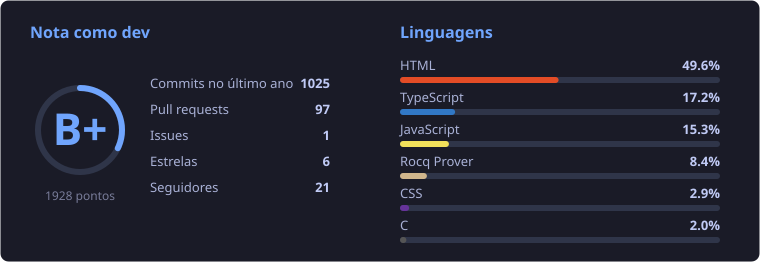

# Arthur Perozin

Desenvolvedor Full Stack focado em entregar soluções eficientes e bem arquitetadas.

4 anos de experiência · Ciência da Computação na UDESC · Foco em IA aplicada

---

## Sobre mim

Sou desenvolvedor Full Stack com **4 anos de experiência** construindo soluções com estruturas robustas, boas práticas e qualidade de código. Atualmente cursando a **4ª fase de Ciência da Computação na UDESC (CCT)**.

Gosto de unir engenharia de software sólida com tecnologias emergentes, sempre buscando soluções de alto impacto, escaláveis e fáceis de manter.

## No que eu trabalho

| | Área | O que faço |
|---|---|---|
| 🤖 | **IA Aplicada** | Projetos com LLMs (Large Language Models), automação de processos e integração de IA em soluções reais |
| ⚡ | **Backend** | Otimização de backends, foco em desempenho e confiabilidade |
| 🌐 | **Full Stack** | Aplicações completas, do front ao back, com arquiteturas modernas |
| 🧱 | **Arquitetura** | DDD, TDD e Clean Architecture para código escalável, testável e de fácil manutenção |

## Métricas

## Boas práticas que eu sigo

- **DDD (Domain-Driven Design):** modelagem orientada ao domínio do negócio
- **TDD (Test-Driven Development):** testes guiando o desenvolvimento
- **Clean Architecture:** separação de responsabilidades e baixo acoplamento

## 🌱 Em constante evolução

Busco aprimorar continuamente meus conhecimentos em **tecnologias emergentes**, **design de sistemas** e **integração de IA** em soluções de alto impacto.

---

⭐ Fique à vontade para explorar meus repositórios!

